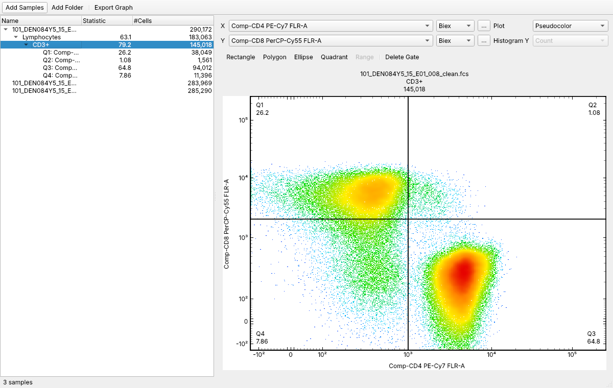
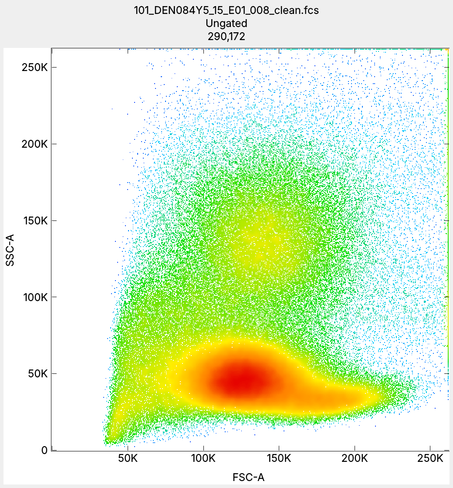
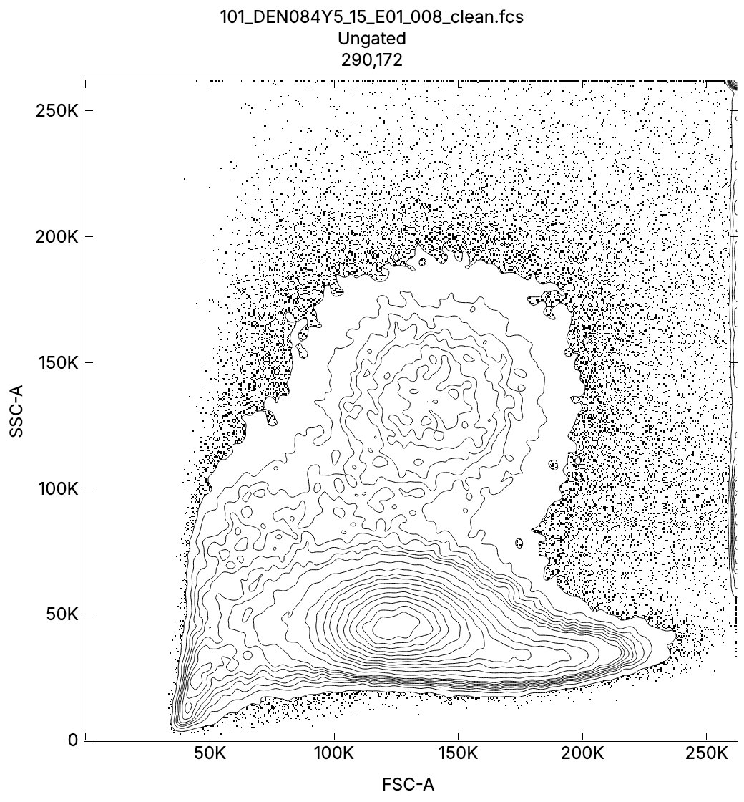
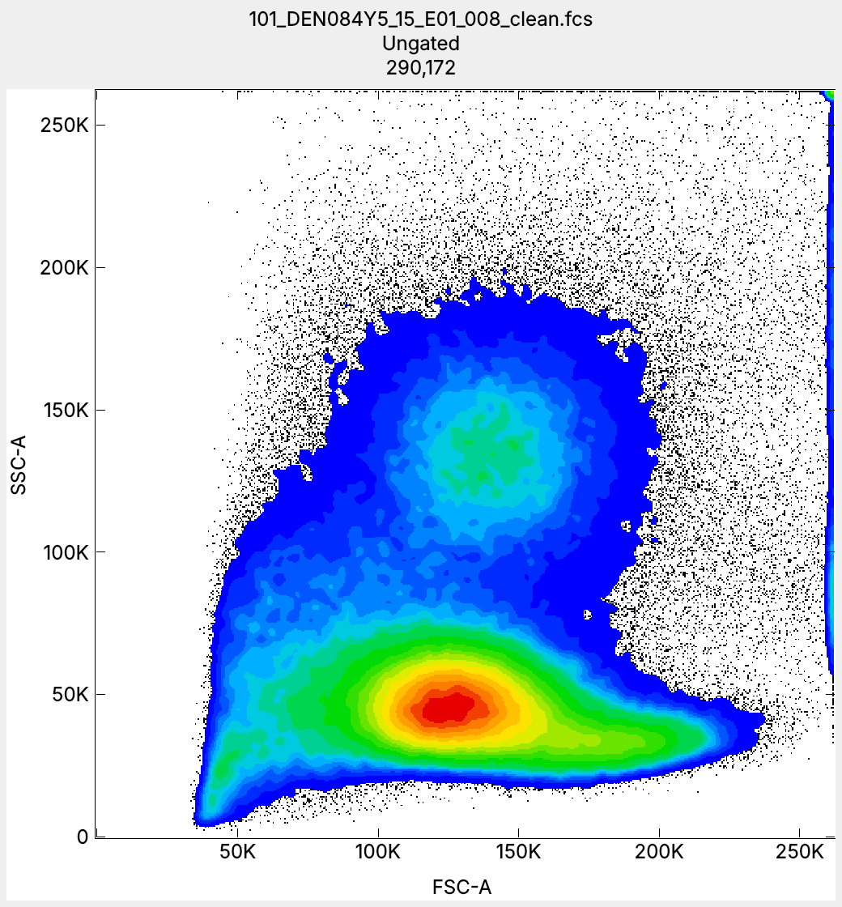
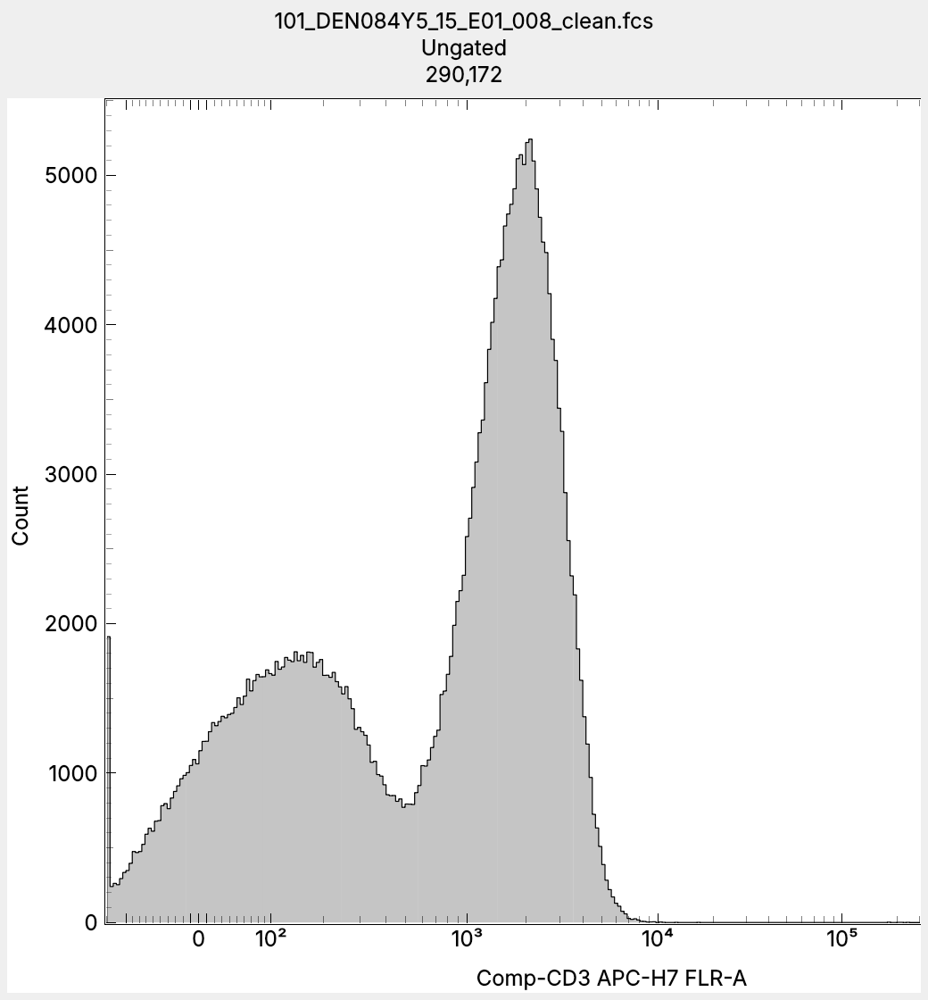

# CytoGate

개인용 유세포 분석(Flow cytometry) 데스크톱 프로그램.

- 라이선스 키 없이 실행
- FCS 파일 읽기, 보정(compensation), 변환, 게이팅, 통계
- FlowJo와 같은 양식의 결과물: Table Editor 형식 통계표, FlowJo 10 `.wsp` 워크스페이스

> CytoGate는 FlowJo와 관련이 없는 독립 프로젝트입니다. FlowJo는 BD의 상표입니다.

진행 계획은 [ROADMAP.md](ROADMAP.md)를 보세요.



## 실행 (Windows)

Python 3.11 이상이 필요합니다. 명령 프롬프트(cmd)에서 저장소 폴더로 이동한 뒤:

```bash
python -m venv .venv
```

```bash
.venv\Scripts\activate
```

```bash
pip install -e ".[gui]"
```

```bash
python -m cytogate gui
```

창이 열리면 **Add Samples…** / **Add Folder…** 로 FCS 파일을 불러오거나, 파일을 창에 끌어다 놓으면 됩니다.

| Pseudocolor | Contour | Density | Histogram |
|---|---|---|---|
|  |  |  |  |

## 개발 환경 설정

```bash
python -m venv .venv
```

```bash
# Windows: .venv\Scripts\activate
source .venv/bin/activate
```

```bash
pip install -e ".[dev]"
```

```bash
python scripts/fetch_test_data.py
```

```bash
pytest
```

## 테스트 데이터

`scripts/fetch_test_data.py`는 [FlowKit](https://github.com/whitews/FlowKit) 저장소(BSD-3)의 공개 예제
FCS 파일과 FlowJo 10 `.wsp` 파일을 `tests/data/`에 내려받습니다. 용량이 커서 저장소에는 넣지 않습니다.
