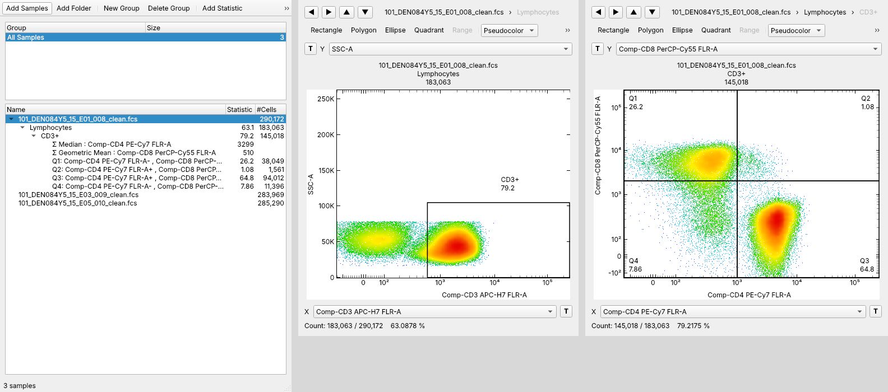

# CytoGate

개인용 유세포 분석(Flow cytometry) 데스크톱 프로그램.

- 라이선스 키 없이 실행
- FCS 파일 읽기, 보정(compensation), 변환, 게이팅, 통계
- FlowJo와 같은 양식의 결과물: Table Editor 형식 통계표, FlowJo 10 `.wsp` 워크스페이스

> CytoGate는 FlowJo와 관련이 없는 독립 프로젝트입니다. FlowJo는 BD의 상표입니다.

진행 계획은 [ROADMAP.md](ROADMAP.md)를 보세요.



## 실행 (Windows)

Python 3.11 이상이 필요합니다. 명령 프롬프트(cmd)에서 저장소 폴더로 이동한 뒤:

```bash
python -m venv .venv
```

```bash
.venv\Scripts\activate
```

```bash
pip install -e ".[gui]"
```

```bash
python -m cytogate gui
```

## 사용법

- **샘플 불러오기:** 작업 공간 창에서 **Add Samples…** / **Add Folder…**, 또는 FCS 파일을 창에 끌어다 놓기
- **그래프 창 열기:** 샘플이나 게이트를 **더블클릭** (Enter). 여러 개를 동시에 열 수 있습니다
- **그래프 창 버튼**
  - ◀ ▶ : 이전/다음 샘플 (같은 게이트·축·그래프 종류 유지, 현재 그룹 순서) — Ctrl+←/→
  - ▲ ▼ : 상위 게이트 / 첫 번째 하위 게이트 — Ctrl+↑/↓
  - 위쪽 경로(샘플 › Lymphocytes › CD3+)를 누르면 그 단계로 이동
  - 축 옆 **T** : 축 변환 창 (Scale, Min/Max, Width Basis 등, 양 끝 −/+ 로 범위 조정, Apply로 적용)
- **게이트:** 그래프 창의 Rectangle / Polygon / Ellipse / Quadrant / Range로 그리기. 도구를 끈 상태에서 게이트 안쪽을 끌면 이동, 라벨을 끌면 라벨만 이동(더블클릭하면 원위치)
- **게이트 복사:** 트리에서 게이트를 여러 개 골라 그룹 표의 **All Samples**(또는 다른 그룹)로 끌어다 놓으면 그 그룹 전체에, 다른 샘플 위에 놓으면 그 샘플에만 복사
- **저장·열기:** File > Save / Open (FlowJo 10 `.wsp`). 옮겨진 FCS 파일은 위치를 물어서 다시 연결, 5분마다 자동 저장
- **키워드·그룹:** Keywords 메뉴(값 입력, 연속 번호, 찾기/바꾸기, 열 표시), Groups > New Group by Keyword, 이름 바꾸기 F2
- **보정:** Compensation > Compensation Matrix Editor (행렬 편집, 단일 염색 대조군으로 계산, AutoSpill)
- **내보내기:** File > Export / Concatenate Populations (FCS·CSV)
- **표:** Reports > New Table — 게이트·통계를 끌어다 놓고 Create Table, To File(CSV/TXT/XLSX/HTML)
- **레이아웃:** Reports > New Layout 또는 그래프 창 File > Add to Layout (Ctrl+L). 게이트를 페이지에 끌어다 놓으면 그래프, 그래프 위에 놓으면 오버레이. Batch / Export로 샘플마다 PDF·PNG·SVG·PowerPoint·웹 페이지 출력

| Pseudocolor | Contour | Density | Histogram |
|---|---|---|---|
|  |  |  |  |

## 개발 환경 설정

```bash
python -m venv .venv
```

```bash
# Windows: .venv\Scripts\activate
source .venv/bin/activate
```

```bash
pip install -e ".[dev]"
```

```bash
python scripts/fetch_test_data.py
```

```bash
pytest
```

## 테스트 데이터

`scripts/fetch_test_data.py`는 [FlowKit](https://github.com/whitews/FlowKit) 저장소(BSD-3)의 공개 예제
FCS 파일과 FlowJo 10 `.wsp` 파일을 `tests/data/`에 내려받습니다. 용량이 커서 저장소에는 넣지 않습니다.
