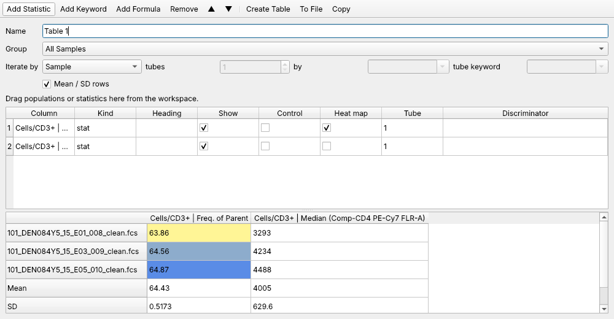
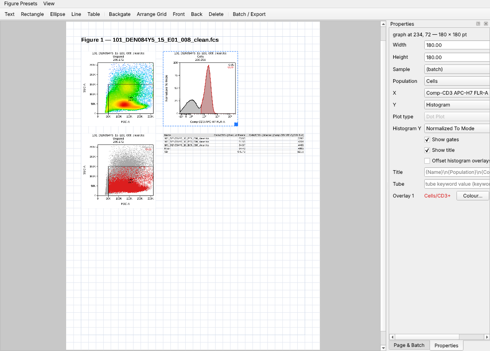
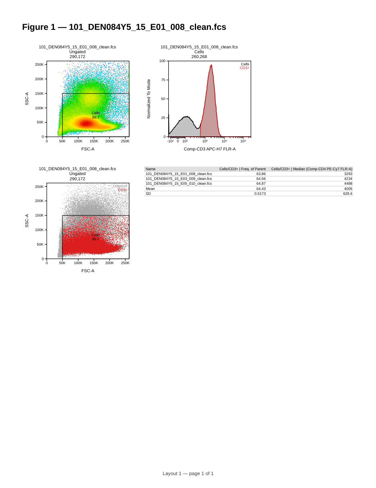

# CytoGate 로드맵

개인용 유세포 분석(Flow cytometry) 데스크톱 프로그램. 라이선스 키 없이 동작하며,
결과물은 FlowJo와 같은 양식(통계 정의·표 열 이름·FlowJo 10 `.wsp` 워크스페이스)을 목표로 한다.

- 플랫폼: Windows 데스크톱 (Python 3.11+ / PySide6 / pyqtgraph)
- 엔진: [FlowKit](https://github.com/whitews/FlowKit) (BSD-3) — FCS 읽기, 보정, 변환, 게이팅, `.wsp` 입출력
- 검증 기준: FlowJo 10이 저장한 `.wsp` 안의 게이트별 이벤트 수(`count`)와 비교

| 단계 | 내용 | 완료 기준 | 상태 |
|---|---|---|---|
| 0. 기반 | 저장소, 프로젝트 구조, 샘플 데이터 스크립트, 테스트 실행 | `pytest` 통과 | ✅ |
| 1. FCS 읽기 | FCS 2.0/3.0/3.1, 키워드, 채널(PnN/PnS), 이벤트 행렬 | 샘플 파일의 채널·이벤트 수 일치 | ✅ |
| 2. 보정·변환 | `$SPILLOVER` 보정, Linear / Log / Biex / Logicle / Arcsinh | FlowJo 변환 참조값과 일치 | ✅ |
| 3. 그래프 | Dot, Pseudocolor, Contour, Density, Histogram | 스크린샷 확인 | ✅ |
| 4. 게이팅 | Polygon, Rectangle, Ellipse, Quadrant, Range, Boolean, 게이트 트리 | `.wsp` 게이트 이벤트 수 일치 | ✅ (FlowJo 9 변환 파일 예외, 아래 참고) |
| 5. 통계 | Count, Freq. of Parent/Total/Grandparent, Median, Mean, Geo. Mean, CV, SD, rCV | FlowJo 계산식과 일치 | ✅ (FlowJo 실제 값 비교는 8단계) |
| 6. 그룹·일괄 적용 | 그룹, 게이트 일괄 적용, 샘플별 조정 | 여러 파일 일괄 처리 | ✅ |
| 7. 출력 | Table Editor, Layout Editor, `.wsp` 저장/열기, 그래프·레이아웃 PDF/PNG/SVG/PPTX/HTML, 게이트 이벤트 FCS/CSV 내보내기 | FlowJo에서 `.wsp` 열기 | ✅ (FlowJo에서 열어보기는 8단계) |
| 8. 검증 | 실제 FlowJo 분석 결과와 1:1 수치 비교 | 차이 리포트 | 🟡 (FlowJo 10.0 공개 데이터로 1차 완료, 최신 FlowJo 통계값 비교는 데이터 확보 후) |
| 9. 배포 | Windows `.exe` (PyInstaller) | 더블클릭 실행 | 🟡 (빌드 자동화 완료, Windows 실행 확인 대기) |
| 선택 | tSNE/UMAP, FlowSOM, 세포 주기, 증식 분석 | — | ⬜ |

각 단계는 별도 브랜치에서 작업하고, 테스트 통과 후 `main`에 합친다.

## 단계별 기록

### 1단계 (FCS 읽기)
- `cytogate.io.load_fcs()` / `load_folder()`, 명령줄 `python -m cytogate info <파일|폴더>`
- 키워드는 파일에 적힌 이름 그대로(`$TOT`, `$P1N` …) 읽으며, FlowJo가 `.wsp`에 기록한 값과 모두 일치
- Time 채널은 FlowJo와 같이 `$TIMESTEP`을 곱한 초 단위
- 표준을 어긴 파일(오프셋 불일치, 잘못된 `$TIMESTEP`)도 읽고 경고를 남김

### 2단계 (보정·변환)
- `cytogate.core.Compensation`: FCS 내장 행렬(FlowJo의 "Acquisition-defined"), CSV, FlowJo XML(`spilloverMatrix`) 읽기/쓰기
- 보정 파라미터는 FlowJo처럼 원본 옆에 `Comp-` 이름으로 추가. 파라미터 목록(이름·순서)이 FlowJo의 `$P1N…$P23N` 기록과 일치
- 변환: Linear, Log, Biex, Logicle, ArcSinh. 모두 FlowJo `.wsp`의 XML 요소와 1:1로 읽고 쓰기
- Biex는 FlowJo에서 내보낸 참조표와 4096 채널 중 0.01 채널 이내로 일치
- Logicle은 Moore & Parks(2012) 공식으로 독립 검산
- 축 눈금: 선형 0, 50K, 100K …, 로그형 0, 10³, 10⁴, 10⁵ (+ 2–9 보조 눈금)
- 기본 변환: 산란광 Linear 0–PnR, Time Linear(실제 범위), 형광 Biex(width −10, pos 4.42)

### 3단계 (그래프)
- 데스크톱 창(PySide6 + pyqtgraph): 샘플 목록(#Cells), X/Y 파라미터, 축 변환 선택·세부 설정, 그래프 종류, PNG 내보내기, 파일 끌어다 놓기
- 그래프: Dot, Pseudocolor(기본), Contour(5% 확률 등고선 + 바깥 점), Density, Histogram(Count / Normalized To Mode)
- 축 범위를 벗어난 이벤트는 FlowJo처럼 축 가장자리에 쌓아 표시
- 계산부(`cytogate.plots`)는 화면 없이 테스트, 화면은 offscreen으로 테스트·스크린샷(`scripts/screenshots.py`)

### 4단계 (게이팅)
- 게이트: Rectangle, Range(히스토그램), Polygon, Ellipse, Quadrant(Q1–Q4), Boolean(AND/OR/NOT), 게이트 바깥(eventsInside="0")
- FlowJo처럼 표시 공간(변환 후)에서 판정. 축 끝에 그린 게이트는 그 방향으로 열린 범위
- 화면: 게이트 도구 모음, 마우스로 그리기, 왼쪽 트리에 Freq. of Parent(%)·#Cells, 그래프 위 게이트 윤곽과 비율, 게이트 삭제
- `.wsp` 읽기(게이트·보정·변환·FlowJo가 저장한 수치)를 이번 단계에서 먼저 구현 — 7단계에서 쓰기 추가
- Time: FlowJo는 `$TIMESTEP`이 아니라 샘플별 gain = (`$ETIM` − `$BTIM`) ÷ 저장된 Time 값 범위를 쓴다. `.wsp`에 기록된 gain과 일치, Time 게이트 수치 3개 샘플 모두 일치

#### FlowJo 수치 비교 결과
- FlowJo 10에서 만든 작업공간(사분면+자식 게이트, Biex, ArcSinh, 타원 등 6개 파일): **모든 게이트 수치 정확히 일치**
- FlowJo 9에서 변환된 "DEN" 작업공간: Time은 일치, Singlets 이하에서 Polygon/Rectangle 최대 약 0.3%, Logicle 축의 타원 최대 약 3.2% 차이.
  원인 미확정(FlowKit도 같은 차이). FlowJo의 Logicle 표시 변환이 공식과 다를 가능성이 가장 큼. 8단계에서 FlowJo 10으로 직접 만든 Logicle 작업공간으로 다시 확인 필요

### 5단계 (통계)
- 통계: Count, Freq. of Parent/Grandparent/Total, Mean, Median, Geometric Mean, Mode, SD, CV, Robust SD, Robust CV, Median Abs Dev, MADP, Percentile
- 정의는 FlowJo 문서 기준(Robust CV = 100 × ½(P84.13 − P15.87) ÷ Median, MADP = 100 × 1.4826 × MAD ÷ Median 등)
- Geometric Mean은 FlowJo 10 방식(축 변환 공간에서 평균 후 역변환, 음수 허용)이 기본, 고전식(양수만 exp(mean(ln x)))도 선택 가능
- 화면: "Add Statistic…"으로 게이트·샘플에 Σ 통계 노드 추가, 트리에 값 표시, Delete로 제거
- Table Editor 열 이름 형식 준비: `Lymphocytes/CD3+ | Median (Comp-R780-A :: CD3)` (7단계 내보내기에서 사용)
- **확인 필요:** 예제 `.wsp`에는 FlowJo가 계산한 Count 외의 통계 값이 없어서 수학적 정의로만 검증. FlowJo는 "binned data"로 통계를 계산한다고 문서에 적혀 있어 끝자리가 다를 수 있음 → 8단계에서 실제 FlowJo 표와 비교

### 사용자 요청 기능: 게이트 라벨 끌어서 옮기기
- 게이트 도구를 끈 상태에서 그래프의 게이트 라벨(이름·비율)을 마우스로 끌면 원하는 위치로 이동, 더블클릭하면 원래 위치로
- 위치는 게이트마다 저장되어 그래프를 다시 그려도 유지 (히스토그램 포함). 7단계에서 `.wsp`의 `annoOffsetX/Y`로 저장 예정

### 6단계 (그룹·일괄 적용)
- 그룹 창: "All Samples"(항상 전체) + 직접 만든 그룹. 트리에서 샘플을 여러 개 골라 "New Group…", 그룹을 고르면 그 샘플만 표시
- "Apply to Group": 선택한 게이트(하위 게이트·통계·라벨 위치 포함) 또는 샘플의 게이트 트리 전체를 현재 그룹의 모든 샘플에 복사. 같은 이름이 있으면 게이트를 교체(중복 없음), 부모 게이트가 없는 샘플은 건너뛰고 알림
- 그룹 소유 게이트는 트리에서 굵게 표시 (FlowJo `owningGroup`과 같은 개념, `.wsp`에서 읽음)
- 게이트를 그래프에서 끌어 옮기기(사분면 제외). 그룹 게이트면 "그룹 전체" 또는 "이 샘플만" 선택. "이 샘플만"은 그룹 연결이 끊겨 이후 그룹 변경에 덮어쓰이지 않음
- 검증: FlowJo DEN 작업공간(모든 게이트가 DEN 그룹 소유)에서 E01의 트리를 그룹에 적용한 결과가 각 샘플 자신의 트리 결과와 일치
- 아직 없음: 게이트 꼭짓점 하나만 끌어 모양 바꾸기, 게이트 이름 바꾸기

### 사용자 요청: FlowJo식 창 구조 (6단계 이후)
- 작업 공간 창(그룹 표 + 샘플/게이트 트리)과 별도의 그래프 창. 더블클릭으로 그래프 창을 열고 여러 개를 동시에 띄움
- 그래프 창: ◀ ▶ 이전/다음 샘플(게이트·축·그래프 종류 유지), ▲ ▼ 상위/첫 하위 게이트(FlowJo 동작은 추정), 경로 클릭 이동, 하단 Count / 상위 수 / 비율
- 축 옆 T 버튼 → 축 변환 창: 히스토그램 미리보기, Scale·Min/Max, Extra Neg. Decades, Width Basis(슬라이더·입력), Positive Decades, Calculate Width Basis, 양 끝 −/+, 그룹 전체 적용, Apply/Cancel
  - Width Basis −100의 Min이 약 −1636으로 FlowJo 화면 예시(−1627.954)와 0.5% 이내
- 트리에서 게이트 여러 개를 그룹으로 끌어다 놓으면 그룹 게이트로 복사, 샘플 위에 놓으면 그 샘플에만 복사

### 사용자 요청: FlowJo Graph Window 구조·기능 (docs.flowjo.com Graph Window 문서 기준)
- Y 파라미터 선택을 Y축 옆 세로 버튼으로 이동(검색 가능한 목록), X는 X축 아래, 각 축 옆 T 버튼
- 메뉴: File(닫기, 모두 닫기, 창 크기 초기화, Export Graphics As PNG/JPG/SVG/PDF/BMP/TIFF, Print), Edit(Undo/Redo, Clear, Copy Image ±투명, Copy Histogram Function 4096 bins, Add Statistic), Graph(Duplicate View, Transpose Axes, Manually Enter Gate), Display(Grid, Large Dots, Gate Frequencies/Names, Medians, Uncompensated Parameters), Go(Workspace, 상위/하위, 다음/이전 샘플, 다음/이전 X·Y)
- 상단: Undo/Redo, ◀ ▶ (Shift: 같은 샘플의 모든 그래프 창), ▲ ▼, 브레드크럼(▸ 그룹 샘플 목록, › 형제 게이트 목록), Duplicate
- T 버튼 메뉴: Linear / Log / Biex / Reset / Customize Axis…, 축 가장자리 이벤트 8% 초과 시 경고 문구 + T 버튼 주황 테두리
- 하단 패널(접기/펼치기): Options(Type, 전경/배경색, Smooth, Show Outliers, Histogram Y), Active Gate(Events Inside, Tint, −/+ 크기), Statistics(Count/부모/비율, 통계 목록, Add Statistics)
- 게이트 클릭 → 활성 게이트(빨간 윤곽 + 꼭짓점/모서리 핸들로 모양 변경), 방향키 1픽셀 이동, Delete 삭제, Esc 선택 해제
- 새 게이트 이름 제안: FlowJo식 "X, Y subset"
- 미구현(문서에 있음): 3D 보기, Graph Window Movies, Magnetic gate, Event # 파라미터 (Copy To Layout Editor는 7단계에서 File > Add to Layout으로 추가)

### 7단계 (사용자 선택 항목: A1, A3, A4, B2, C1, D1, D2, E1, F1–F4, G1, J1)
- **J1 통계:** FlowJo식 4096-bin 계산(기본값, 정확 계산으로 전환 가능), Robust SD 축 밖 이벤트 규칙, Freq. of <상위 게이트>
- **A1 워크스페이스:** File > Save / Save As / Open (`.wsp`, FlowJo 10 형식) — 게이트·그룹·보정·변환·키워드·통계·라벨 위치 저장, 옆 파일 `<이름>.wsp.cytogate.json`에 CytoGate 전용 정보(키워드 그룹 조건, 표·레이아웃 정의) 저장. FCS 파일이 옮겨졌으면 찾아 다시 연결, 5분마다 자동 저장, 닫을 때 저장 여부 확인
- **A3·A4 키워드·편집:** 키워드 열 표시, 정렬, 필터, 값 입력·연속 번호·찾기/바꾸기·스프레드시트 붙여넣기, 게이트·그룹 이름 바꾸기(F2, Boolean 참조 자동 수정), 키워드 조건 그룹(자동 갱신), 통계 노드 끌어다 그룹/게이트에 복사, 샘플 속성 창
- **B2 그래프 옵션:** 세 번째 파라미터 중앙값으로 점 색칠, Contour 단계(%)·해상도 설정
- **C1 게이트:** AND/OR/NOT, Boolean 조합 일괄 생성, Bisector(BifurGate 자동 분할), Spider, Curly·Offset Quadrant
- **D1·D2 보정·변환:** 보정 행렬 편집기, 단일 염색 대조군 마법사(중앙값 방식, AutoSpill 반복 회귀), 그룹 적용/해제, 변환 기본값 저장(Save as Default), 변환 복사
- **G1 내보내기:** 게이트 이벤트를 FCS 3.1 / CSV(스케일 값, 채널 값) 로 내보내기, 여러 파일 합치기(전부·n개씩·키워드 값별, SampleID 파라미터)
- **E1 Table Editor** (Reports > New Table): 게이트를 끌어오면 Freq. of Parent 열, 통계 노드를 끌어오면 그 통계 열. 키워드 열, 수식 열(`{열 이름}` 사칙연산·log 등), Control·Show·Heat map, 샘플별 / n개 튜브 패널별 / 키워드 값별 반복, Mean·SD 행, CSV·TXT·XLSX(히트맵 색 포함)·HTML·클립보드
- **F1–F4 Layout Editor** (Reports > New Layout, 그래프 창 File > Add to Layout):
  - 게이트를 끌어다 놓으면 그래프, 그래프 위에 놓으면 오버레이(색 변경·삭제), 선택 그래프 Backgate(상위 게이트 그래프 위에 빨간색으로 표시)
  - 텍스트(`{Name}` `{Population}` `{Count}` `{Page}` `{Pages}` `{Date}` `{키워드}` 치환), 사각형·타원·선, Table Editor 표
  - 격자 표시·맞춤, 크기 조절(오른쪽 아래 모서리), 앞/뒤 순서, 격자 정렬, 머리글·바닥글, 용지 크기·가로 방향
  - 일괄 출력(Batch): 그룹의 샘플마다 / 키워드 값마다 복사본, 페이지마다·가로로·세로로 배치 → PDF(여러 페이지), PNG/JPG/TIFF·SVG(페이지별 파일), PowerPoint(그래프는 그림, 텍스트는 편집 가능한 텍스트 상자), HTML(웹 페이지 한 파일)
  - 그림 양식 저장(Figure Presets): 레이아웃을 양식으로 저장해 새 레이아웃에 재사용
- 확인하지 못한 것 (8단계 검증 대상): FlowJo 방식 통계값을 실제 FlowJo 표와 비교, AutoSpill은 합성 데이터로만 검증, 저장한 `.wsp`를 실제 FlowJo에서 열어보기, 화면에서 직접 끌어다 놓기는 놓기 처리 코드로만 시험

| Table Editor | Layout Editor | 출력된 페이지 |
|---|---|---|
|  |  |  |

### 8단계 (검증) — 1차: FlowJo 공개 튜토리얼 데이터
- 데이터: FlowJo 공식 GitHub 저장소 [FlowJo/FlowJo-VR](https://github.com/FlowJo/FlowJo-VR)의 `8 Color PBMC/Lesson_8.wsp` (FlowJo 10.0) + FCS 35개. `python scripts/fetch_test_data.py --flowjo-vr`로 받음 (약 100MB)
- 실행: `python scripts/validate_flowjo.py <wsp> <FCS 폴더> --csv 결과.csv` — 워크스페이스에 FlowJo가 저장한 모든 게이트 이벤트 수와 통계값을 CytoGate로 다시 계산해 비교. 결과표: `docs/validation/flowjo_vr_lesson8.csv`
- 이 워크스페이스에는 FlowJo가 다시 계산하지 않은 오래된 값이 섞여 있음 (서로 다른 파일 A1·C8·C9에 T cells 19,666개로 같은 값). 여러 샘플에서 똑같이 반복되는 값은 비교에서 제외

| 항목 | 비교 수 | 차이 중앙값 | 90% 이내 | 최대 |
|---|---|---|---|---|
| 게이트 이벤트 수 | 98 | 0.013% | 0.20% | 0.96% |
| Median | 41 | 0.06% | 0.48% | 2.3% |
| Robust CV | 32 | 0.13% | 0.60% | 2.6% |
| Freq. of Total | 8 | 0.02% | 0.04% | 0.05% |

- 이벤트 수 차이는 게이트 경계 근처 몇 개 이벤트 (예: 22,697 vs 22,695). 이 파일들은 값이 64 단위 격자에 있고 게이트 꼭짓점도 같은 격자에 있는데, 경계선 1 단위 안에 있는 이벤트는 없어서 경계 판정 규칙 문제는 아님. 4096/1024/256 채널 해상도로 판정하는 가설도 시험했지만 일치가 나아지지 않음 → 원인 미확인 (FlowJo 10.0이 격자 값을 조금 흔들어 처리하는 것으로 추정)
- Median·Robust CV 차이는 대부분 위의 이벤트 수 차이(집단 구성 차이)에서 옴
- 이전 단계에서 FlowJo 10 워크스페이스(FlowKit 예제)의 이벤트 수는 정확히 일치 확인됨
- 이번에 고친 것:
  - FlowJo 10.0 형식(Gating-ML 1.5 네임스페이스) 워크스페이스 읽기
  - FlowJo가 파라미터 이름의 "/"를 "_"로 바꿔 저장하는 것 (`FITC/Alexa 488-A` → `FITC_Alexa 488-A`) 복원 — 보정·변환·게이트·통계 모두
  - FlowJo 10 통계 이름(`fj.stat.freqofparent` 등)과 "Freq. of Total"(ancestor="Total") 읽기, FlowJo 10.0은 Freq. of를 비율(0–1)로 저장
  - FCS 2.0 비트 단위 압축 정수 데이터($PnB 9 등) 읽기 — 해석 방식(앞쪽 비트부터)은 표준 해석이며 실제 기기 파일로는 미검증
- 사용하지 못한 데이터: LabKey 테스트 데이터(FlowJo 10.8, 통계 다수)는 FCS 내용이 무작위 값으로 바뀌어 있어(개인정보 보호로 추정) 비교 불가. FlowRepository FR-FCM-Z6UG는 사이트 인증서 만료로 다운로드 불가
- 남은 일: 최신 FlowJo(10.8 이상)가 계산한 Median/Mean/CV/Geo. Mean/SD 값과 원본 FCS가 함께 있는 데이터로 FlowJo 방식(4096칸) 통계 비교

### 9단계 (배포)
- `packaging/cytogate.spec` (PyInstaller, 폴더형 빌드 — 한 파일형보다 실행이 빠름), 아이콘 `packaging/cytogate.ico` (`packaging/make_icon.py`로 생성), 버전 정보
- `CytoGate.exe --selftest [결과.txt]`: 가상 FCS를 만들어 읽기·보정·게이팅·통계·`.wsp` 저장/열기·FCS/CSV 내보내기·표(CSV/TXT/XLSX/HTML)·레이아웃(PDF/PNG/SVG/PPTX/HTML)·창 열기까지 점검. 빌드에서 빠진 파일이 있으면 여기서 드러남
- GitHub Actions `Windows build`: main에 올릴 때마다 Windows에서 테스트 → exe 빌드 → 자체 점검 → zip을 Artifacts로 저장. `v*` 태그를 올리면 Release에 zip 첨부
- 크기 줄이기: pyarrow(160MB, pandas 선택 기능), 쓰지 않는 Qt 모듈(QML/Quick/PDF/WebEngine 등) 제외 → Linux 빌드 기준 588MB → 425MB (압축 전)
- Linux에서 같은 spec으로 빌드한 실행 파일의 자체 점검 통과 확인. Windows exe는 GitHub Actions 결과로 확인
